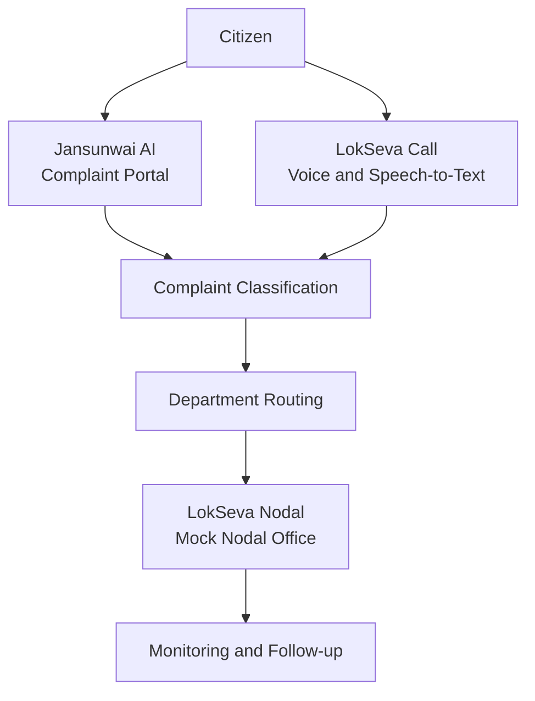

# LokSeva AI 🇮🇳
### AI-Powered Citizen Grievance Classification, Routing & Nodal Monitoring

**Team:** `fihhhh`  
**Project Type:** Hackathon Prototype

LokSeva AI is a civic-tech prototype designed to make citizen grievance handling more organized and transparent. It brings together a citizen-facing complaint experience, a voice-calling and speech-to-text simulator, and a nodal-office command center to demonstrate how a complaint can move from submission to departmental routing and follow-up.

> **Disclaimer:** This is a hackathon demonstration. The linked portals are prototype/mock environments and are not official government services. Do not submit real personal, financial, or sensitive information.

## 🔗 Live Demo

| Component | Description | Link |
|---|---|---|
| **Jansunwai AI** | Main citizen grievance web app for complaint classification and routing | [Launch App](https://jansunwai-ai.ai.studio) |
| **LokSeva Call** | Voice calling and speech-to-text simulator | [Launch Simulator](https://loksevacall.ai.studio) |
| **LokSeva Nodal** | Mock nodal-office command center for grievance monitoring | [Open Portal](https://lokseva-nodal.ai.studio) |
| **Technical Architecture** | Technical architecture and AI pipeline presentation | [View on Gamma](https://gamma.app/docs/LokSeva-Technical-Architecture-AI-Pipeline-e9urmbwfptnasrq) |

## 🚩 Problem Statement

Citizen grievances may arrive in different formats and need to be reviewed, categorized, and forwarded to the appropriate department. Manual triage can create delays, inconsistent categorization, and limited visibility into the complaint lifecycle.

An effective grievance-management workflow should help citizens submit complaints accessibly, assist with classification and routing, and give administrative teams a clearer view of incoming and pending grievances.

## 💡 Our Solution

LokSeva AI demonstrates a connected grievance-management workflow through three complementary interfaces:

- **Jansunwai AI:** The main complaint interface, focused on smart complaint classification and routing.
- **LokSeva Call:** A voice-oriented entry point demonstrating calling and speech-to-text interaction.
- **LokSeva Nodal:** A simulated administrative interface for monitoring and managing grievance flow.

Our goal is to demonstrate how AI-assisted triage can reduce manual sorting and make complaint routing easier to understand.

## ✨ Key Features

- **Smart Complaint Classification:** Organizes complaint information into meaningful categories.
- **Department Routing:** Helps recommend the appropriate department for a grievance.
- **Voice-Based Intake:** Demonstrates a voice-first approach through the calling simulator.
- **Speech-to-Text:** Explores converting spoken complaints into text.
- **Nodal Monitoring:** Represents the administrative perspective of grievance handling.
- **Connected Demo Experience:** Brings together citizen-facing, voice-intake, and nodal-office interfaces.

*These capabilities describe the prototype's intended workflow. Official case registration, real government-system integration, and real-world grievance resolution are not implied.*

## 🔄 System Workflow

1. A citizen begins through the complaint portal or voice simulator.
2. Complaint information enters the grievance workflow.
3. The system demonstrates complaint classification and department-routing concepts.
4. The nodal-office interface represents the administrative monitoring side.
5. The workflow can be demonstrated using the available prototype interfaces and data.

## 🎬 Hackathon Demo Flow

1. **Introduce the problem:** Explain the challenges of manually sorting and routing citizen grievances.
2. **Demonstrate Jansunwai AI:** Walk through the citizen-facing complaint workflow.
3. **Demonstrate LokSeva Call:** Show the voice-oriented complaint intake experience.
4. **Open LokSeva Nodal:** Present the administrative monitoring interface.
5. **Explain the architecture:** Use the technical presentation to describe the AI pipeline and system design.
6. **Highlight the impact:** Show how assisted classification and clearer routing could improve grievance handling.

## 🧱 Architecture Overview

| Layer | Responsibility |
|---|---|
| Citizen Interface | Accepts grievance information |
| Voice Interface | Demonstrates calling and speech-to-text intake |
| AI Classification and Routing | Interprets complaint information and recommends a category or department |
| Nodal-Office Interface | Represents administrative monitoring and follow-up |

For the detailed architecture, refer to the [LokSeva Technical Architecture & AI Pipeline presentation](https://gamma.app/docs/LokSeva-Technical-Architecture-AI-Pipeline-e9urmbwfptnasrq).

## 🛠️ Technology and Setup

The project is presented through web-based prototype interfaces. Refer to the source files in this repository for the exact implementation stack, dependencies, environment variables, and local setup commands.

If running the source locally, keep API keys and other secrets out of version control. Use environment variables and provide a `.env.example` file where applicable.

## ⚠️ Scope and Limitations

- This is a hackathon prototype demonstrating a grievance-management workflow.
- The linked portals are mock/demo environments, not official government websites.
- Do not claim a complaint has been officially registered unless an authorized integration has been implemented and verified.
- AI-generated classifications and department recommendations may be incorrect and should be reviewed by a responsible human.
- Speech recognition can be affected by language, accent, background noise, and recording quality.
- Do not use real sensitive citizen data in the demonstration.
- A production deployment would require security controls, privacy safeguards, access management, auditability, accessibility testing, and verified integrations with authorized systems.

## 🚀 Future Scope

- Improved multilingual complaint intake and regional-language support.
- Similar-complaint detection and duplicate warnings.
- Clearer complaint tracking and citizen notifications.
- Department workload analytics and escalation workflows.
- Human review and correction of AI classifications.
- Secure, authorized integrations with real grievance-management systems where permitted.
- Stronger privacy, access controls, audit logs, and production-grade data storage.

## 👥 Team

**Team Name: fihhhh**

Built for a hackathon focused on using AI to improve the citizen grievance experience.

## 📚 Project Resources

- [Jansunwai AI — Main Web App](https://jansunwai-ai.ai.studio)
- [LokSeva Call — Voice Calling Simulator](https://loksevacall.ai.studio)
- [LokSeva Nodal — Mock Nodal Office](https://lokseva-nodal.ai.studio)
- [LokSeva — Technical Architecture & AI Pipeline](https://gamma.app/docs/LokSeva-Technical-Architecture-AI-Pipeline-e9urmbwfptnasrq)

---

**LokSeva AI — Making grievance handling clearer, more accessible, and easier to follow.**

**Collaborators:**
- Aditya Sharma
